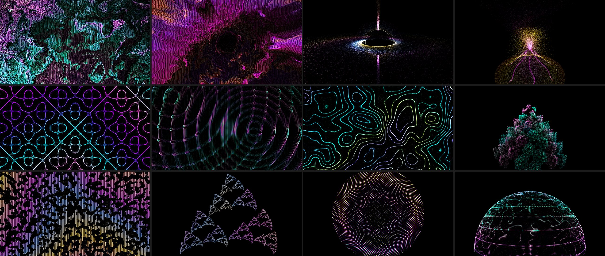

# dj-vj

Automatic, music-reactive visuals for home DJ sessions. rekordbox plays through a Pioneer DDJ-FLX4. A copy of the master mix reaches a browser engine through BlackHole, and the engine drives fullscreen visuals on a 1080p projector. Nobody touches it during the set.



*Twelve of the particle-swarm scenes, rendered straight from the scene code on a simulated kick: peak (top row), main (middle), breakdowns and interludes (bottom).*

**Status:** V1 is done (2026-10-03). It passed a 3.5-hour house-party set with no crash, no frame gaps and no thermal throttling. Since then every scene has become an original particle swarm (the Butterchurn presets went on 2026-10-09), and scenes are grouped into pools for each moment of a set (2026-10-10). Next comes a live set on this build, then V1.1: recording a set and rendering it to video afterwards.

## How it works

- **The DJ setup is never touched.** rekordbox's PC MASTER OUT sends a copy of the master output to BlackHole, a virtual audio device. The engine listens only to that copy. Master output, headphone cue and the controller behave exactly as they would without dj-vj.
- **The engine** runs in Chrome. It analyses the audio every frame (spectrum, kick, tempo, loudness) and sorts the music into **main**, **dark** (a played tempo held at 136 BPM or more — the harder, faster later part of a set) and **peak**. It also flags short events: **breakdown**, **drop**, **ambient interlude** and **silence**.
- **The director** picks a scene to suit what it hears, and decides when to switch. Each moment — main, dark, peak, breakdown, ambient interlude and silence — has its own **pool** of scenes, listed in one file (`engine/src/scenes/pools.ts`) and chosen by hand on the curation page. A drop cuts hard to a peak scene: the one shown before its breakdown, if there was one. A change from one particle swarm to another morphs the dots from one shape into the next.
- **The compositor** draws the scene, steps the render size down if frames run slow, and runs the **flash limiter**. No scene is trusted to limit its own flashing.
- **Scenes are code.** Every scene is original, and every one is a particle swarm — glowing dots that flow between shapes, so any scene can morph into the next: cells, curves, rings, lasers, shards, a dot liquid, halftone fields such as Turing coral, a Chladni plate and a golden-angle sunflower, fractals and living forms such as a fern, a romanesco, a dividing cell and jellyfish, a black hole, a Lorenz attractor, and more, including nine that reinterpret the [Butterchurn](https://github.com/jberg/butterchurn) (MilkDrop) presets the project used until 2026-10-09. Scenes are deterministic: time comes from the session clock and randomness from a seed.

The full design is in [`docs/design.md`](docs/design.md): requirements, architecture, the character model, director rules and failure handling. Measured results are in [`docs/spike-findings.md`](docs/spike-findings.md).

## Requirements

- macOS on Apple silicon. The target is a fanless MacBook Air M4 with 16 GB.
- rekordbox (tested on 7.2.16) with a controller.
- [BlackHole 2ch](https://github.com/ExistentialAudio/BlackHole).
- Google Chrome. The launcher opens Chrome itself, with a dedicated profile.
- Node 24, Python 3.14 with [uv](https://docs.astral.sh/uv/), and the Xcode command-line tools (for `swiftc`).
- A projector or second display.

## One-time setup

1. Install BlackHole 2ch, then run `sudo killall coreaudiod` in Terminal. BlackHole does not appear as a device until Core Audio restarts.
2. In Audio MIDI Setup, set BlackHole 2ch to **44.1 kHz**. rekordbox runs at 44.1 kHz, and a mismatch makes the master output itself play fast.
3. Set the projector display's wallpaper to solid black, so that a Chrome crash shows black and not the desktop.
4. Build the app:
   ```bash
   launcher/build-app.sh
   ```
   This compiles the small audio-output helper, builds the engine, and writes `VJ.app` to `~/Applications`. Run it again after any change to the engine.

## Running a set

1. Connect the projector and start rekordbox.
2. Double-click **VJ** in `~/Applications`. The launcher checks that BlackHole is at 44.1 kHz and that a projector is connected, then switches the Mac's sound output to BlackHole. A dialog asks you to turn PC MASTER OUT on.
3. In rekordbox, turn **PC MASTER OUT** off and on again, then click **OK**. Chrome opens fullscreen on the projector, and the visuals start moving with the music within a few seconds.
4. DJ as normal. You can use the laptop screen for rekordbox freely. If Chrome crashes or the page hangs, the launcher relaunches it.
5. To finish, click once on the projector picture (the pointer is hidden there), then press **q**. Chrome closes, and the Mac's sound output goes back to what it was before launch.
6. Turn PC MASTER OUT off in rekordbox. If it stays on, the next time rekordbox starts it will also play the mix through the laptop speakers.

Only two keys work on the wall: **q** quits, and **d** toggles a tuning overlay that is off by default. There are no live controls, by design.

## Logs

Logs go to `logs/` (gitignored). Each session gets its own folder, `logs/<session>/`, and the launcher appends to one shared file:

| File | Contents | Why it is kept |
|---|---|---|
| `<session>/frames.jsonl` | Frame times, render scale and the current scene, once a second | The watchdog relaunches Chrome when these stop arriving, so this log cannot be switched off |
| `<session>/scene-log.jsonl` | Every director decision and audio event | Diagnosing a set afterwards; V1.1 replays it to render video |
| `launcher.log` | Launches, relaunches, quits, the restored output | Diagnosing the launcher |

The per-frame audio-feature log (`features.jsonl`, about 20 MB an hour) is off for normal sessions. Use it only for a tuning set: run the dev servers below and open the page with `?features=1`.

## Development

```bash
uv run server/serve.py --port 8765 --root engine/dist   # log server
cd engine && npm run dev                                # engine on http://localhost:5173/
```

- `http://localhost:5173/`: the wall. Click once to start audio capture.
- `http://localhost:5173/curate.html`: the curation page. It plays any scene against live audio or an audio file, with keys to step through scenes. New scenes are signed off on the projector here.
- Analyse a recording offline (writes the same features log the wall would):
  ```bash
  cd engine && AUDIO=<file> OUT=<features.jsonl> npx vitest run src/analysis/audiofile.test.ts
  ```

**Tests:**

```bash
cd engine && npm test
cd server && uv run --with pytest pytest -q
```

Tests use synthetic signals only. Audio is never committed.

## Repository layout

| Path | Contents |
|---|---|
| `engine/src/audio` | BlackHole capture and the silent-stream guard |
| `engine/src/analysis` | Spectrum, kick detector, beat clock, character model |
| `engine/src/director` | Scene choice and timing |
| `engine/src/render` | Compositor, flash limiter, frame watch |
| `engine/src/scenes` | Scene files (folders keep the names of the old families) and `pools.ts`, which says where each scene shows |
| `engine/src/session` | Session ID, log batching, state carried across a page reload |
| `server/serve.py` | Standard-library HTTP server: serves the page, receives logs, handles quit |
| `launcher/` | `vj.sh` session launcher, `audio.swift` output switcher, `build-app.sh` |
| `docs/` | Design, and spike and live-set findings |

## Credits

- **The particle-swarm look is inspired by [AI Particle Simulator](https://particles.casberry.in/) by Casberry India**, and many swarm forms (saturn, power core, butterfly, jellyfish, black hole, aurora, Lorenz attractor and others) are redrawn after shapes in its gallery, including ones shared by its community. No code or assets were copied: each form was written from scratch after looking at screenshots. Credit and thanks to Casberry India and those gallery authors.
- **Nine swarms reinterpret MilkDrop presets** played through [Butterchurn](https://github.com/jberg/butterchurn) in earlier versions: Airhandler (Aderrasi + Geiss), Red Liquid Fire, jelly showoff parade, disconnected, Thumbdrum Tokamak, True Visionary, _Mig_085, mother-of-pearl and stormy sea. Each keeps its preset's colour, motion and mood, written fresh as a swarm; the preset is named in its scene file.

## Licences

The code is released under the [MIT licence](LICENSE). Original scenes are written from scratch, not ported from Shadertoy, whose default licence is non-commercial. Anything borrowed records its source and licence in its scene file.
